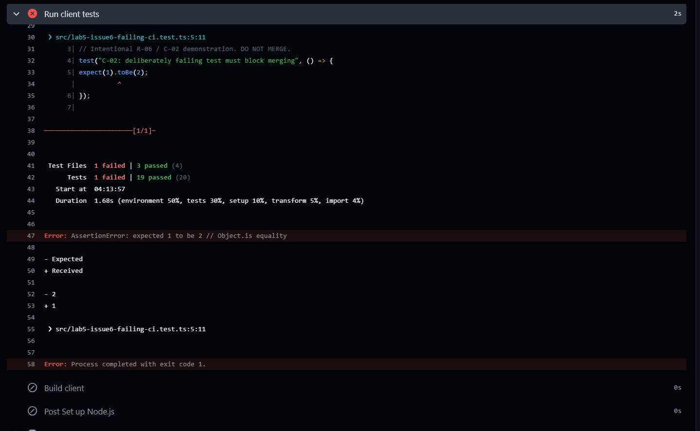
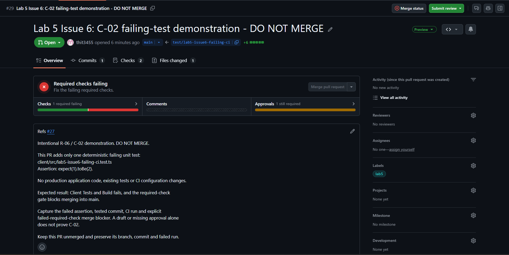
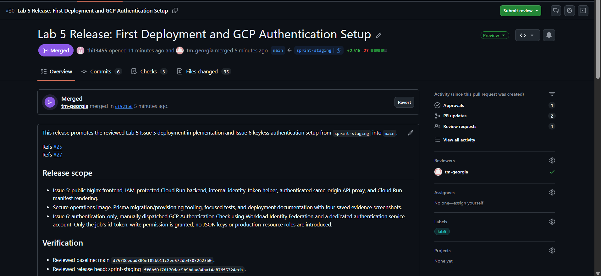
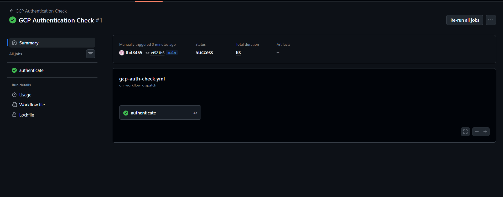

# Lab 5 Issue 6 (#27): GCP Access and Merge Gate

Documentation snapshot: **22 November 2026**. Requirement references are the official Lab 5 handout, Sections 4.1, 7-9 and 12: **R-06, R-09, R-10 and C-02**.

This record separates verified configuration, completed CI and authentication results, and remaining submission evidence. GCP configuration results below come from the preceding authorized read-back verification. Final GitHub rulesets, effective branch rules, Issue #27 metadata, actual review comments and historical CI metadata were read back for this update; no authentication run, CI demonstration or GCP configuration operation was repeated. Screenshot originals were inspected without modification.

## 1. Status and scope

| Item | Status and evidence scope |
|---|---|
| GCP WIF configuration | **PASS:** all nine configuration read-back checks passed; this is configuration evidence, not a live GitHub authentication result. |
| Authentication workflow implementation | **PASS:** [PR #28](https://github.com/tm-georgia/workflow-and-approval-system/pull/28) merged into `sprint-staging`; all three ordinary CI checks passed. |
| Main and staging merge gates | **PASS:** both rulesets remain active/effective with zero bypass actors. Both main and staging require all three CI checks, as detailed in Section 4. |
| R-06 / C-02 | **PASS, historical demonstration:** the intentional client assertion failed, GitHub marked that check required, and the open non-draft PR showed an explicit failed-required-check merge blocker. See Figures 6.1-6.2. |
| Repository Actions variables | **PASS:** all three repository variables were read back and exactly match Section 3. They are non-secret identifiers. |
| Release into `main` | **PASS:** [PR #30](https://github.com/tm-georgia/workflow-and-approval-system/pull/30) merged into `main` at `ef521b600b3548449487df7eeda5f5cea076c4a1`, with teammate approval and all three CI checks passing. The substantive-comment limitation remains below. |
| Live GitHub-to-GCP authentication | **PASS:** [run 44987606342](https://github.com/tm-georgia/workflow-and-approval-system/actions/runs/44987606342), one manual execution from `main` at the release commit. OIDC exchange and service-account impersonation succeeded. |
| R-09 substantive review evidence | **MISSING:** PR #28's approval comment is generic; PR #30's approval body is empty. Neither PR has discussion or inline comments supplying specific technical-review rationale. |
| Issue state | [Issue #27](https://github.com/tm-georgia/workflow-and-approval-system/issues/27) is **OPEN** and labeled `lab5`. Project-board membership remains **UNVERIFIED** because the current authorization lacks `read:project`. |

Local documentation branch: `docs/lab5-issue-6-evidence`, created from `origin/sprint-staging` at `ff8bf017d170dac5b9bdaa84ba14c876f5324ecb`; an authorized fetch of `main` and `sprint-staging` confirmed that the latest staging tip still matches that base, so no rebase or merge was needed. Current remote `main` is `ef521b600b3548449487df7eeda5f5cea076c4a1`. The temporary failing-test branch remains at `a41dfcd4fb9643ca5273a41ad441216071f4e7df`. This finalization is authorized to commit and push only Issue 6 documentation/validated evidence and open a non-draft PR into `sprint-staging`, labeled `lab5`, referencing `Refs #27`, with reviewer `tm-georgia`. It does not merge the PR, close Issue #27, rerun demonstrations or modify settings, IAM or GCP resources.

Worktree isolation was verified before editing: this existing root worktree is on `docs/lab5-issue-6-evidence`; Issue 7 is on `feature/lab5-issue-7-8-cd` in the separate `.local/worktrees/lab5-issue-7-8` worktree. No Issue 7 branch, index or files were changed. Before synchronization, the two documentation files and all eight screenshot originals were backed up under ignored `.local/issue6-finalization/before`; their original SHA-256 values were retained. No stash, reset, clean, checkout or local-file removal was needed.

## 2. Verified WIF configuration and permissions

| Setting | Verified value |
|---|---|
| Project ID / number | `cpe334-workflow-approval-2026` / `597719179612` |
| Application region | `asia-southeast1`; WIF resources use `global`. |
| GitHub repository | `tm-georgia/workflow-and-approval-system` |
| Immutable repository / owner IDs | `1448556407` / `186666746` |
| Authentication service account | `workflow-github-auth@cpe334-workflow-approval-2026.iam.gserviceaccount.com`, enabled |
| Pool | `projects/597719179612/locations/global/workloadIdentityPools/github-actions`, ACTIVE |
| Provider | `projects/597719179612/locations/global/workloadIdentityPools/github-actions/providers/github-auth`, ACTIVE |
| OIDC issuer | `https://token.actions.githubusercontent.com` |
| Required enabled APIs | `iam.googleapis.com`, `iamcredentials.googleapis.com`, `sts.googleapis.com`, `cloudresourcemanager.googleapis.com` |

All six mappings were read back successfully:

```text
google.subject = assertion.sub
attribute.repository_id = assertion.repository_id
attribute.repository_owner_id = assertion.repository_owner_id
attribute.ref = assertion.ref
attribute.event_name = assertion.event_name
attribute.workflow_ref = assertion.workflow_ref
```

All five provider conditions must hold:

```text
attribute.repository_id == '1448556407' &&
attribute.repository_owner_id == '186666746' &&
attribute.ref == 'refs/heads/main' &&
attribute.event_name == 'workflow_dispatch' &&
attribute.workflow_ref == 'tm-georgia/workflow-and-approval-system/.github/workflows/gcp-auth-check.yml@refs/heads/main'
```

Default provider audience validation remains enabled, with no explicit audience override. The WIF provider audience is separate from the Cloud Run backend audience used by the existing frontend token helper.

The authentication service account has exactly one incoming IAM binding: **`roles/iam.workloadIdentityUser` on this service account**, for this principal:

```text
principalSet://iam.googleapis.com/projects/597719179612/locations/global/workloadIdentityPools/github-actions/attribute.workflow_ref/tm-georgia/workflow-and-approval-system/.github/workflows/gcp-auth-check.yml@refs/heads/main
```

Read-back found **zero direct project-level role grants** to this account and **zero user-managed keys**. No service-account JSON key was created or retrieved. This statement is scoped to the checks performed; it is not an exhaustive assertion about every inherited or public-resource permission. Issue 6 granted no deployment, database or production-secret access. Existing frontend/backend/operations identities and human roles were not modified by the WIF setup.

Authentication-only verification stays separate from Issue 7 deployment authorization. A future deployment identity and its resource-scoped permissions require a separately reviewed plan; the authentication account must not silently gain deployment roles.

## 3. Workflow implementation and verified variables

Source: [authentication workflow](../../../.github/workflows/gcp-auth-check.yml), introduced by commit [`606454da6fbf617ca694ec9036f612102d4cf312`](https://github.com/tm-georgia/workflow-and-approval-system/commit/606454da6fbf617ca694ec9036f612102d4cf312).

- Name: `GCP Authentication Check`; trigger: `workflow_dispatch` only.
- Job guard: `github.ref == 'refs/heads/main'`. Ordinary PR CI does not authenticate to GCP.
- Default permissions: empty; authentication job: only `id-token: write`. No checkout or repository-content permission is needed for this token-only check.
- Official authentication action pinned to `google-github-actions/auth@7c6bc770dae815cd3e89ee6cdf493a5fab2cc093` (verified v3 commit).
- Requests an access token with a 300-second lifetime; `create_credentials_file: false` and `export_environment_variables: false`.
- The final step tests only whether an access-token output exists and prints a fixed success message. It does not print the token, store credentials as artifacts, deploy, or call production-resource APIs.

Local implementation validation passed: YAML parsing/duplicate-key checks, checksum-verified actionlint v1.7.12 syntax/expression validation, official action input/source inspection, permission/WIF compatibility checks, and Git whitespace checks. Those validations were not rerun as live authentication during documentation preparation.

The following **non-secret repository Actions variables** were read back successfully and exactly match the approved configuration:

| Variable | Verified value | Verification |
|---|---|---|
| `GCP_PROJECT_ID` | `cpe334-workflow-approval-2026` | PASS: exact match |
| `GCP_AUTH_SERVICE_ACCOUNT` | `workflow-github-auth@cpe334-workflow-approval-2026.iam.gserviceaccount.com` | PASS: exact match |
| `GCP_WIF_PROVIDER` | `projects/597719179612/locations/global/workloadIdentityPools/github-actions/providers/github-auth` | PASS: exact match |

No GitHub secret is required for these identifiers. The workflow is now present on `main`; its Git blob `268153630b8f91fadcb863dba12c6109db8cad99` exactly matches the approved implementation. See the [released workflow](https://github.com/tm-georgia/workflow-and-approval-system/blob/ef521b600b3548449487df7eeda5f5cea076c4a1/.github/workflows/gcp-auth-check.yml) and the completed authentication result in Section 5.2. Do not dispatch it again merely to collect documentation.

## 4. Verified main and sprint-staging quality gates

| Setting | Main quality gate | Staging quality gate |
|---|---|---|
| Ruleset | [27825087: Lab 5 - Main Quality Gate](https://github.com/tm-georgia/workflow-and-approval-system/rules/27825087) | [27825271: Lab 5 - Staging Quality Gate](https://github.com/tm-georgia/workflow-and-approval-system/rules/27825271) |
| Enforcement / effective branch protection | ACTIVE / verified effective | ACTIVE / verified effective |
| Target | `~DEFAULT_BRANCH`, currently `main` | `refs/heads/sprint-staging` |
| Exclusions / bypass actors | None / 0 | None / 0 |
| Approving reviews required | 1 | 1 |
| Dismiss stale approvals | Enabled | Enabled |
| Resolve review conversations | Required | Required |
| Branch up to date before merge | Required | Required |
| Restricted deletions / blocked force pushes | Enabled / enabled | Enabled / enabled |
| Required checks | `Client Tests and Build`; `Server Tests and Build`; `Private Backend Proxy Checks` | `Client Tests and Build`; `Server Tests and Build`; `Private Backend Proxy Checks` |
| Code-owner review / last-push approval | Disabled / disabled | Disabled / disabled |
| Extra approval for unattributed changes | Required | Required |
| Allowed merge methods | Merge, squash, rebase | Merge, squash, rebase |

The required checks are bound to GitHub Actions integration ID `15368`. Current effective rules and ACTIVE enforcement were read back again for both branches. GraphQL confirms zero bypass actors on both rulesets. The main selector follows the default branch if that default changes.

**Final gate parity verified:** the teammate saved `Private Backend Proxy Checks` on the main ruleset, whose API `updated_at` is **22 November 2026, 12:23:24.162 Bangkok time**. This session independently read back all three required checks on both the saved rulesets and effective rules for `main` and `sprint-staging`. All retained protections in the table remain enabled; GraphQL verifies zero bypass actors. Both rulesets enforce required checks on branch creation as well. The earlier two-check main configuration was historical; PR #30 passing the proxy check alone was not proof that it was required then. The historical client-failure demonstration remains valid. This session changed no settings.

The [final verification snapshot](evidence/issue06-final-verification.json) preserves the read-only API sources, final gate settings, branch SHAs, actual review bodies, issue-label result, project-access limitation and screenshot hashes. This API evidence is not a settings screenshot; the missing visual evidence remains listed in Section 7.

## 5. PR #28: implementation, review, merge and passing CI

| Artifact | Verified record |
|---|---|
| Implementation PR | [#28: Add keyless GCP authentication verification](https://github.com/tm-georgia/workflow-and-approval-system/pull/28), labelled `lab5` |
| Feature commit | `606454da6fbf617ca694ec9036f612102d4cf312`; one new workflow file |
| Merge | Into `sprint-staging`, commit `ff8bf017d170dac5b9bdaa84ba14c876f5324ecb`; 22 November 2026, 11:04:49 Bangkok time |
| CI | [Run 44980098231](https://github.com/tm-georgia/workflow-and-approval-system/actions/runs/44980098231), completed successfully |
| Check results | `Client Tests and Build`: PASS; `Server Tests and Build`: PASS; `Private Backend Proxy Checks`: PASS |
| Teammate review | [Approval by tm-georgia](https://github.com/tm-georgia/workflow-and-approval-system/pull/28#pullrequestreview-6010230789) on the feature commit, distinct from author `thit3455` |

**R-09 limitation:** the approval comment is exactly, "Your work looks pretty fine." It confirms an approval was submitted, but does not identify a specific check, question, finding or reason. No inline review comments were found during the review audit. Do not describe this as substantive technical-review evidence. Future reviews must state actual checks/findings; no reviewer statement or historical review has been invented or rewritten here.

PR #28 was the staging implementation step. PR #30 subsequently released the workflow to main, as recorded below. Its merge and later authentication success do not retroactively improve PR #28's review comment.

### 5.1 PR #30: completed release to main

| Artifact | Verified record |
|---|---|
| Release PR | [#30: First Deployment and GCP Authentication Setup](https://github.com/tm-georgia/workflow-and-approval-system/pull/30), `main` <- `sprint-staging`, labeled `lab5`, references `Refs #25` and `Refs #27` |
| Reviewed base / head | `d75786edad306ef02b911c2ee572db35052623b0` / `ff8bf017d170dac5b9bdaa84ba14c876f5324ecb` |
| Scope | Six commits, 35 files, 2,516 additions and 27 deletions: Issue 5 authenticated proxy, token helper, Cloud Run templates, operations-image security fixes, provisioning, tests, documentation and four earlier screenshots, plus the Issue 6 authentication workflow |
| Merge | By `tm-georgia` into `main` at `ef521b600b3548449487df7eeda5f5cea076c4a1`, 22 November 2026 at 11:58:42 Bangkok time |
| CI | [Run 44986998293](https://github.com/tm-georgia/workflow-and-approval-system/actions/runs/44986998293), release head `ff8bf017d170dac5b9bdaa84ba14c876f5324ecb`: all three client, server and private-proxy checks PASS |
| Approval | [tm-georgia's approval](https://github.com/tm-georgia/workflow-and-approval-system/pull/30#pullrequestreview-6010469461), 11:58:31 Bangkok time, on the reviewed head |
| Exclusions | The deliberate failing test from PR #29 was absent. This local Issue 6 record, its deployment-index additions and screenshots 07/08 were not included in PR #30. Screenshots 13/14 were supplied later. |

**R-09 still limited:** PR #30's approval body is empty. Current read-back of PRs #28 and #30 found no discussion or inline review comments supplying a specific check, finding, question or approval rationale. An approval and a successful merge are verified; substantive technical-review evidence is not. Do not invent a historical review. Any follow-up should record a genuine review or obtain the instructor's acceptance of the limitation.

**Deployment provenance remains unverified:** promoting reviewed source into main does not establish exact equivalence between that source and the previously deployed immutable images. Preserve [Issue 5's provenance limitation and credential-rotation follow-up](deployment.md#131-deployment-results-and-provenance). No deployment or credential rotation occurred during this release/authentication documentation work.

### 5.2 Completed live keyless authentication

| Artifact | Verified record |
|---|---|
| Run | [44987606342: GCP Authentication Check](https://github.com/tm-georgia/workflow-and-approval-system/actions/runs/44987606342), completed SUCCESS |
| Trigger / ref / attempt | One approved `workflow_dispatch` by `thit3455` from `main`; attempt 1; created 22 November 2026 at 12:01:57 Bangkok time |
| Tested main commit | [`ef521b600b3548449487df7eeda5f5cea076c4a1`](https://github.com/tm-georgia/workflow-and-approval-system/commit/ef521b600b3548449487df7eeda5f5cea076c4a1) |
| Authentication job | [authenticate](https://github.com/tm-georgia/workflow-and-approval-system/actions/runs/44987606342/job/137101499321): `Authenticate through WIF` and `Confirm authentication without displaying credentials` both succeeded |
| Authentication result | Google accepted GitHub OIDC federation and service-account impersonation for `workflow-github-auth@cpe334-workflow-approval-2026.iam.gserviceaccount.com`; the access-token presence check passed |
| Safe confirmation | The prior authorized log inspection found exactly `PASS: GitHub OIDC exchange and service-account impersonation.` No token value was displayed or saved in this record. |

The workflow requests a 300-second access token, creates no credential file and exports no credentials into the environment. The observed success proves this authentication path; it does not prove deployment permissions or access to Cloud Run, Cloud SQL or production secrets. No such resource calls were part of the workflow. Neither repository workflow has a `push` or PR `closed` trigger: merging PR #30 did not automatically authenticate or deploy. The successful manual run is completed evidence, not an instruction to rerun it.

## 6. PR #29: intentional failing-test demonstration (R-06 / C-02)

| Artifact | Verified record |
|---|---|
| Demonstration PR | [#29: C-02 failing-test demonstration - DO NOT MERGE](https://github.com/tm-georgia/workflow-and-approval-system/pull/29), non-draft, target `main`, labelled `lab5`, body `Refs #27` |
| Branch / head commit | `test/lab5-issue6-failing-ci` / `a41dfcd4fb9643ca5273a41ad441216071f4e7df` |
| Historical base | `d75786edad306ef02b911c2ee572db35052623b0`, matching remote `main` during the demonstration; current main has advanced through PR #30 |
| Change scope | Exactly one commit adding only `client/src/lab5-issue6-failing-ci.test.ts`; no production code, existing-test or workflow edits |
| CI run | [44984116918](https://github.com/tm-georgia/workflow-and-approval-system/actions/runs/44984116918), completed with the expected FAILURE |
| Failed required check | [Client Tests and Build](https://github.com/tm-georgia/workflow-and-approval-system/actions/runs/44984116918/job/137090826839) |
| Passing required check | [Server Tests and Build](https://github.com/tm-georgia/workflow-and-approval-system/actions/runs/44984116918/job/137090827042) |
| Intended failure | `expect(1).toBe(2)`; `AssertionError: expected 1 to be 2`; file position `5:11` |
| Client test summary | 1 failed, 19 passed, 20 total; dependency installation succeeded and the subsequent client build was skipped |
| Actual CI checkout | Synthetic PR merge commit `e1a73c3303db41ef4ddd3d6b9a5552c099f699d5`; its tree was verified equal to the approved head tree. This was not a release or an actual merge into main. |

The focused local command previously produced the same intentional assertion failure:

```powershell
npm.cmd --prefix client test -- src/lab5-issue6-failing-ci.test.ts
```

This command is a historical record, not an instruction to rerun it during documentation work. CI subsequently ran the full client suite and confirmed exactly one deliberate failure.

While PR #29 was **open and non-draft**, GitHub reported `Client Tests and Build` with `isRequired: true`, `conclusion: FAILURE`, and PR `mergeStateStatus: BLOCKED`. Reviewer approval was also outstanding (`REVIEW_REQUIRED`). Figure 6.2 explicitly shows **"Required checks failing"** and **"1 required failing"**, so the captured evidence identifies the failed-check blocker, not merely missing approval or draft status. R-06 / C-02 is supported by the combined failed assertion, required-check configuration, API verification and open-PR screenshot.

**Current state differs from the screenshot:** PR #29 is **closed without merging** (22 November 2026, 11:23:36 Bangkok time). Its branch still exists remotely and locally at the same head. The screenshot records its earlier open/blocked state; current closure by itself is not proof of a CI gate. The failed run and original screenshots remain preserved; the intentional test is excluded from the release.

Issue #27 is now **OPEN** and labeled `lab5`. Its history records closure by `thit3455` at 11:05:21 and reopening by `thit3455` at 11:40:49 Bangkok time on 22 November 2026. The label was added during the separately approved release-PR task. Project-board membership remains **UNVERIFIED**: the final read-only GraphQL attempt again returned `INSUFFICIENT_SCOPES` for `read:project`. The browser access host was unavailable, so no authorized browser-based board verification or settings screenshot was obtained. No authorization was broadened. Current issue/PR states were read back without changing them. Preserve the demonstration branch, commit, PR and failed run; do not fix, merge or repeat it for evidence.

## 7. Saved evidence, captions and gaps

All eight saved PNGs were visually inspected and checked for PNG integrity. Originals were not renamed, moved or modified; SHA-256 hashes were checked before and after the documentation changes. The four Issue 6 images below show no visible passwords, hashes, JWTs, access tokens, private keys or credential-bearing connection strings. Public repository/user names, branch names, commit SHAs and test assertions are not authentication secrets. The four earlier Issue 5 images retain the personal university-email/profile-information caveat in [the Issue 5 index](deployment.md#136-evidence-index-and-remaining-documentation-work); no visible authentication secrets were found in them either. These checks do not prove that previously exposed demonstration credentials have been rotated.



**Figure 6.1 - C-02 / R-06:** [PR #29](https://github.com/tm-georgia/workflow-and-approval-system/pull/29), tested head `a41dfcd4fb9643ca5273a41ad441216071f4e7df`, [failed client job](https://github.com/tm-georgia/workflow-and-approval-system/actions/runs/44984116918/job/137090826839) in run `44984116918`. The deliberate `expect(1).toBe(2)` assertion fails at `src/lab5-issue6-failing-ci.test.ts:5:11`; 1 test fails and 19 pass. The image is cropped and does not show the run URL or commit header, so retain this caption and direct links in the submission.



**Figure 6.2 - C-02 / R-06:** [PR #29](https://github.com/tm-georgia/workflow-and-approval-system/pull/29), target `main`, head `test/lab5-issue6-failing-ci` at `a41dfcd4fb9643ca5273a41ad441216071f4e7df`. Captured while open: **"Required checks failing"**, **"1 required failing"** and a disabled merge button; the title says **DO NOT MERGE** and `lab5` / `Refs #27` are visible. One approval is also outstanding. The browser URL and full SHA are not pictured; the caption supplies the verified artifact links and SHA. The PR is now closed unmerged, as recorded above.



**Figure 6.3 - Release traceability:** [PR #30](https://github.com/tm-georgia/workflow-and-approval-system/pull/30) shows Merged, `main` <- `sprint-staging`, merge abbreviation `ef521b6`, six commits, 35 changed files, the teammate's approval indicator, `lab5` and both issue references. The Checks tab shows a count of three, but the screenshot does not expand their results or show a substantive review comment. Pair it with [the passing CI run](https://github.com/tm-georgia/workflow-and-approval-system/actions/runs/44986998293) and the review limitation in Section 5.1; the caption supplies the full merge SHA.



**Figure 6.4 - Live keyless authentication:** [run 44987606342](https://github.com/tm-georgia/workflow-and-approval-system/actions/runs/44987606342) shows `GCP Authentication Check #1`, manual trigger, `main`, short commit `ef521b6`, overall Success and successful `authenticate` job. The screenshot does not show the expanded steps, fixed PASS message, full SHA or browser URL. Pair it with [job 137101499321](https://github.com/tm-georgia/workflow-and-approval-system/actions/runs/44987606342/job/137101499321), full SHA `ef521b600b3548449487df7eeda5f5cea076c4a1` and the verified result in Section 5.2. No additional execution is needed; an expanded-step screenshot can be captured from this existing run if desired.

| Evidence ID | Requirement / artifact | Availability and limits |
|---|---|---|
| E6-01 | C-02 / R-06: intentional failure | **AVAILABLE:** [07-c02-failed-test-summary.png](evidence/07-c02-failed-test-summary.png), Figure 6.1; pair with the CI run/job link and head SHA. |
| E6-02 | C-02 / R-06: required check blocks merge | **AVAILABLE:** [08-c02-blocked-merge.png](evidence/08-c02-blocked-merge.png), Figure 6.2; historical open-PR state, not current closure. |
| E6-03 | Main required-check settings | **PENDING screenshot:** no main-quality-gate screenshot is saved here; `06-main-quality-gate.png` is only a suggested future filename. The verified ruleset link/settings and saved API evidence are in Section 4. |
| E6-04 | Staging quality-gate settings | **PENDING screenshot:** proposed `09-sprint-staging-quality-gate.png`; verified ruleset link/settings and saved API evidence in Section 4. |
| E6-05 | GCP WIF pool/provider and scoped trust | **PASS recorded read-back; screenshots PENDING:** proposed `10-wif-provider-trust.png` and `11-wif-service-account-iam.png`. Capture identifiers, mappings/conditions and IAM scope only, never token/key contents. |
| E6-06 | Passing CI and teammate review | **PASS CI/approval links:** PR #28/run `44980098231` and PR #30/run `44986998293`, review permalinks in Section 5. **MISSING substantive R-09 rationale.** |
| E6-07 | GitHub repository Actions variables | **PASS exact read-back:** Section 3. Optional supporting screenshot `12-github-actions-variables.png` is not saved. |
| E6-08 | Staging-to-main release | **AVAILABLE:** [13-release-pr-main.png](evidence/13-release-pr-main.png), Figure 6.3; PR #30 merged at `ef521b600b3548449487df7eeda5f5cea076c4a1`. Approval is verified; substantive-review evidence remains missing. |
| E6-09 | Live keyless authentication | **AVAILABLE:** [14-gcp-authentication-success.png](evidence/14-gcp-authentication-success.png), Figure 6.4; successful run `44987606342` at the release SHA. Step details are verified through the linked job and prior safe log inspection. |
| E6-10 | R-09 / R-10 traceability | Issue #27 is **OPEN**, labeled `lab5`; PRs #28/#29/#30 also carry the label. Project-board membership remains **UNVERIFIED** due to missing `read:project` authorization. |
| E6-11 | Final submission | **PENDING:** incorporate links/captions into the required Lab 5 PDF's Answer Part 1 and relevant Part 0/4 index rows. No PDF was created here. |

Saved inventory: `01-cloud-run-services.png`, `02-migration-jobs.png`, `04-reviewer-dashboard.png`, `05-requester-approved.png`, `07-c02-failed-test-summary.png`, `08-c02-blocked-merge.png`, `13-release-pr-main.png`, and `14-gcp-authentication-success.png`. Suggested filenames 06 and 09-12 are absent and are not rendered as existing image links. Numbering gaps are not failures; the evidence coverage described above is what matters.

## 8. Remaining work and completion boundary

### Local review validation

The final review fetched the latest `main` and `sprint-staging` refs. Staging remained at `ff8bf017d170dac5b9bdaa84ba14c876f5324ecb`, already the documentation branch's base; no synchronization changes or conflict resolution were needed. The existing local Markdown and all eight screenshot originals were backed up before editing. Only the two Issue 6 documentation paths, four supplied Issue 6 PNGs and the final verification JSON are selected for the commit. Application, CI, deployment configuration and Issue 7 files are outside the change.

Validation passed for all 31 relative documentation links/anchors, preservation of every prior linked URL and full 40-character commit/blob SHA, all eight PNG signatures/chunk CRCs/compressed image streams and original SHA-256 hashes, whitespace and credential patterns in the changed documentation and evidence. All eight PNGs were visually reinspected: the Issue 6 captions match their visible content and no visible authentication secrets were found. Historical CI run/job metadata, source links, variables, issue label, rulesets and actual review bodies were read back without rerunning jobs. Project-board membership remains unverified for the access reasons above. Screenshot settings gaps and the earlier Issue 5 personal-profile caveat remain explicit.

The authorized documentation PR uses base `sprint-staging`, head `docs/lab5-issue-6-evidence`, title **Lab 5 Issue 6: Final GCP Authentication and Merge Gate Evidence**, label `lab5`, reference `Refs #27` and reviewer `tm-georgia`. Its current three-check CI result and documentation commit SHA are recorded in the PR and final handoff; historical runs in Sections 5-6 are preserved as separate evidence. PR creation or passing CI does not supply teammate approval or resolve R-09.

### Mandatory remaining submission work

1. Resolve the R-09 substantive-review evidence gap through an actual technical review or instructor acceptance of the documented limitation. Do not invent comments or imply a later comment existed before the merge.
2. Verify Issue #27's required project-board membership through a teammate's authorized UI/read-only access; record the result. This task does not broaden authorization or change the board.
3. Save readable main-gate settings evidence (`06-main-quality-gate.png`) for the C-02 submission, retaining the existing historical failed-check screenshots and links. Do not repeat the failure or authentication demonstration.
4. Assemble the required Lab 5 PDF with Answer Part 1 and relevant Part 0/4 index entries, captions, run/PR links and full SHAs. Reconcile any still-unverified human GCP access/Free Trial handout evidence before claiming full lab completion; it was not re-audited here.
5. Obtain an actual teammate technical review/approval on the new documentation PR. Committing, pushing and creating that PR are explicitly authorized for this finalization; review/approval and merge remain separate. PR #30 did not contain this documentation or the four Issue 6 images. Issue #27 stays open.

The separate Issue 5 security follow-up remains mandatory before further demonstration use or handoff: obtain separately authorized rotation of exposed demo credentials, as recorded in [deployment.md](deployment.md#134-completed-security-architecture-and-iam). It was not performed or verified by this task. Exact deployed-source equivalence remains unverified.

### Optional supporting evidence and improvements

- Save staging/WIF/service-account settings screenshots using proposed names `09-sprint-staging-quality-gate.png`, `10-wif-provider-trust.png` and `11-wif-service-account-iam.png`. Their configuration evidence is already recorded; no screenshots are invented. Include these if the final submission checklist requires visual proof of those settings.
- Save `12-github-actions-variables.png` and an expanded-step view from existing authentication run `44987606342`; API/job links already support the recorded results. Never expose tokens or rerun the workflow for a screenshot.
- Prepare a submission copy that omits unnecessary personal email/profile identifiers in the older Issue 5 images, preserving the originals.

Variables, release to main, historical C-02 and live keyless authentication are verified complete. **The final Issue 6 documentation and evidence are prepared for the explicitly authorized PR submission; full lab submission readiness remains conditional on the mandatory evidence and review items above.** This work leaves the PR unmerged and Issue #27 open. No cloud operation or repeat demonstration was performed.
