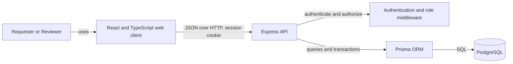

# Part C — System-Level Software Design Specification

## 1. Purpose and design scope

The Workflow and Approval System lets a Requester submit a request, then lets an authorized Reviewer make and record an approval decision. This document describes the local Sprint 1 implementation as revised on 12 November 2026. Verification and outstanding review/release gates are recorded in [the Sprint 1 report](sprints/sprint-1/verification.md).

Sprint 1 is a local working increment. The later cloud deployment design is included for planning; Docker, CI/CD, and GCP deployment are not part of this deliverable.

## 2. Architecture and component responsibilities

| Component | Technology | Responsibility |
|---|---|---|
| Web client | React, TypeScript, Vite | Sign-in; Requester submission/history with decision metadata; Reviewer assigned pending list and approve/reject actions; validation, loading, empty, success, error, retry, and duplicate-decision suppression. |
| API/application layer | Node.js, Express, TypeScript | Authenticate users, identify the current user, enforce role and ownership permissions, validate input, apply workflow rules, and return JSON responses. |
| Database | PostgreSQL with Prisma ORM | Persist users, password hashes, requests, workflow status, ownership, and decision metadata. Prisma schema and migrations define repeatable database structure. |

The browser sends same-origin `/api` requests to the Express API. During local development, Vite proxies `/api` requests to the backend on port 3000. The API uses Prisma to communicate with PostgreSQL. Business rules and authorization are enforced in the API; client-side controls are for usability and are not security controls.

## 3. Data design

The current Prisma schema defines these entities:

| Entity | Important fields | Relationships and constraints |
|---|---|---|
| `User` | `id`, unique `email`, `passwordHash`, `role`, `createdAt` | A user has the `REQUESTER` or `REVIEWER` role. A user may submit many requests and may review many requests. Passwords are stored as bcrypt hashes, never as plain text. |
| `Request` | `id`, `title`, `description`, `status`, `requesterId`, optional `assignedReviewerId`, optional `reviewerId`, `createdAt`, optional `decidedAt` | Required Requester owner; separate optional assigned-Reviewer and deciding-Reviewer relations. Owner deletion is restricted; deleting an assigned/deciding Reviewer sets that optional link to null. New requests default to `PENDING`. Assignment/status/time/ID index supports the review list. |

`RequestStatus` is `PENDING`, `APPROVED`, or `REJECTED`. `assignedReviewerId` is populated by the server using the designated seeded Reviewer on new submissions. Existing rows stay unassigned after the additive `20261112000000_reviewer_assignment` migration; no backfill or destructive operation is performed. The designated account must currently have the Reviewer role, otherwise submission returns `503` without saving.

F-03 permits a decision only for an assigned, non-self-owned `PENDING` request. A Prisma transaction conditionally updates the row using ID, pending status, assignment, and non-self-ownership predicates, saving final status, deciding `reviewerId`, and `decidedAt` in one write. A competing attempt finds zero eligible rows and returns `409` without changing the winner's decision. The API rechecks record access before disclosing a workflow conflict. No public reassignment operation exists.

The minimum Sprint 1 decision/history entry consists of these final decision fields on the Request. The PATCH response and owning Requester's `/mine` retrieval expose them; the Requester UI displays decision identity/time. Extended event history, reasons, and resubmission remain later-sprint proposals, not changes to this status enum. Schema/migrations remain under `server/prisma/`.

The local database is PostgreSQL, database name `workflow_approval`, on port 5432. The connection string is supplied through `DATABASE_URL`; the actual credential belongs only in the untracked `server/.env`. The Prisma seed procedure creates synthetic Requester and Reviewer accounts for local demonstration. Seed passwords are development-only and must not be reused as real credentials.

## 4. User interface and navigation

| Screen/state | Behavior |
|---|---|
| Sign-in | Accepts email and password, offers show/hide password, and displays an error for failed sign-in. |
| Requester workspace | Title/description form, explicit save success, and own request history/status. Available decision identity/time is shown. Empty and error states are displayed. |
| Loading/current-user check | On page load, asks the API whether a valid signed-in user exists. A valid Requester’s requests are then loaded. |
| Reviewer workspace | Lists only assigned, non-self-owned pending requests. Approve/Reject controls are disabled while saving; a synchronous guard suppresses duplicate clicks. Success removes the decided row and refreshes the list. Loading/empty/error/retry states are shown. A failed refresh after a successful PATCH retains success and cannot offer a second decision for that row. |

Forms require their fields and the API repeats validation. A successful request submission clears the form and reloads the Requester’s history. Network and API failures are shown without exposing internal database or secret details.

## 5. API and access conventions

The API uses JSON for request and response bodies. Protected endpoints require the signed-in identity established by the session cookie. A client-supplied user ID or role is never trusted for authorization or ownership.

### Implemented Sprint 1 endpoints

| Method and path | Access | Purpose and response |
|---|---|---|
| `POST /api/auth/login` | Public | Accepts `{ "email": "...", "password": "..." }`. On success, sets an HTTP-only session cookie and returns user ID, email, and role. Invalid credentials return `401`; malformed input returns `400`. |
| `POST /api/auth/logout` | Public; clears any session cookie | Clears the authentication cookie and returns `204`. |
| `GET /api/auth/me` | Signed-in user | Returns authenticated user ID, email, and role; signed-out or invalid sessions return `401`. |
| `POST /api/requests` | Requester only | Accepts `{ "title": "...", "description": "..." }`. The API derives `requesterId` from the signed-in user and creates a `PENDING` request. Invalid or empty fields return `400`; wrong role returns `403`; signed-out access returns `401`. |
| `GET /api/requests/mine` | Requester only | Returns only requests whose `requesterId` matches the signed-in user. |
| `GET /api/health` | Public local health check | Checks database connectivity and reports whether the database is connected. It does not return private request data. |

### F-03 endpoint design

| Method and path | Access and behavior |
|---|---|
| `GET /api/requests/pending` | Reviewer only; returns assigned, non-self-owned `PENDING` Requests ordered by `createdAt`, then `id`. `200` array, including `[]`; `401`/`403` for session/role failure, safe `500` for database failure. |
| `PATCH /api/requests/:id/decision` | Assigned non-owner Reviewer only. JSON `{ "decision": "APPROVED" }` or `REJECTED`. Positive canonical 32-bit integer ID. Returns saved Request (`200`); invalid ID/body `400`; invalid session `401`; wrong role/assignment/self-owner `403`; missing record `404`; repeated/concurrent decision `409`; safe `500` on failure. |

Both return only Request fields, never User hashes/tokens. The [F-03 contract](sprints/sprint-1/F-03-reviewer.md) defines detailed response fields, errors, AC, and tests. Express's final error middleware returns safe JSON for malformed JSON (`400`) and otherwise unhandled failures (`500`).

Errors use a JSON object with a user-safe `error` message. Internal exception details, SQL, passwords, tokens, and secrets are not returned to clients. Endpoint-specific status codes distinguish unauthenticated (`401`), forbidden (`403`), invalid input or invalid workflow state (`400` or the status agreed in the feature contract), missing item (`404`), and unexpected server failure (`500`).

## 6. Role and permission matrix

| Operation | Signed-out visitor | Requester | Reviewer |
|---|---:|---:|---:|
| Sign in | Allowed | Allowed | Allowed |
| Sign out / retrieve current identity | No private identity | Own session only | Own session only |
| Submit a request | Denied | Allowed; ownership comes from session | Denied |
| List own requests | Denied | Allowed; only own records | Denied |
| List pending requests for review | Denied | Denied | Assigned, non-self-owned pending records only |
| Approve or reject a pending request | Denied | Denied | Assigned non-owner only; pending-only atomic write |

Existing authentication/role middleware is reused without changing F-01. F-03 enforces assignment, self-approval prevention, and pending-only decisions in the API regardless of displayed controls. Requester privacy continues to use a session-owned database filter.

## 7. Authentication and credential handling

Local passwords are checked with `bcryptjs`; only password hashes are stored. Successful login creates a signed JSON Web Token (JWT) with a one-hour expiry and sends it in an HTTP-only cookie named `accessToken`. The cookie uses `SameSite=Lax`, the `/` path, and `Secure` in production. Browser JavaScript cannot read the HTTP-only cookie. The client retrieves current identity from `GET /api/auth/me`; logout clears the cookie. Protected requests reject missing, expired, invalid, or unknown-user sessions.

The JWT signing secret is provided by `JWT_SECRET` and must be long, random, and private. The database connection string is provided by `DATABASE_URL` and is also private. Both belong in local untracked `server/.env` for development and a secret store for deployment. Neither may be committed to Git, included in client code, or shown in screenshots/PDFs.

## 8. Configuration, reproducibility, and future delivery

| Variable | Purpose | Handling |
|---|---|---|
| `DATABASE_URL` | Connects Prisma to PostgreSQL | Keep the real value in local untracked `server/.env` or deployment secret storage. |
| `JWT_SECRET` | Signs and verifies login tokens | Use a strong random secret in local untracked `server/.env`; use managed secret storage in deployment. |
| `NODE_ENV` | Selects development/production behavior, including secure cookies | Set to `production` in production. |
| `DESIGNATED_REVIEWER_EMAIL` | Selects the seeded Reviewer used for new submissions | Optional; demo default `reviewer@example.test`. Must identify an existing Reviewer. No new assignment UI is introduced. |
| `PORT`, `HOST` | API listener | Defaults `3000`, `127.0.0.1`; configure `HOST=0.0.0.0` inside a deployed container. |

The [README](../README.md) records dependency installation, private local configuration, migrations/seed, development/run, production build, and verification commands. `server/scripts/test-local.mjs` creates a fresh loopback-only PostgreSQL cluster using an independent synthetic identity and ephemeral JWT secret. It overrides inherited database configuration, retains local logs, and stops the cluster without deleting data. The original test fixture cleanup is confined to that isolated cluster. Optional `--smoke` runs the built HTTP server and verifies owner retrieval across an application restart.

For Lab 5, the intended design is a Docker-packaged web/API application, managed PostgreSQL with durable storage, and GCP-managed runtime and secret configuration. The application must read configuration from environment variables and must not depend on files inside a disposable application container for database persistence. Actual Docker, CI/CD, and GCP setup are deferred to Lab 5.

## 9. Known design and implementation gaps at this revision

- F-03 is implemented locally; review, versioned contract/code history, integration, and accepted release evidence remain outstanding. See the verification report rather than inferring acceptance from code presence.
- F-04-F-07 remain proposed in Parts B/D; later-sprint FR/BR/design reconciliation is still required before that scope is finalized.
- F-02 validates non-empty title and description in the API; the client also limits title length to 120 characters. If this maximum is a product rule, enforce it in the API too and document/test it in the F-02 contract.
- Existing unassigned rows require a separately approved backfill if the team wants them reviewed. This task changes no developer database or `.env` file.
