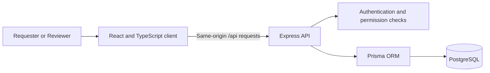

# Part C — System-Level Software Design Specification

## 1. Purpose and scope

The Workflow and Approval System provides an authenticated workflow for departmental purchase requests. A Requester submits a request and views its status. An authorized Reviewer reviews it and records an approval or rejection.

This document describes the current Sprint 1 design and the intended later-sprint architecture. It distinguishes working behavior from planned behavior.

## 2. Architecture

The system uses three logical layers:

| Layer | Technology | Responsibilities |
|---|---|---|
| Web client | React, TypeScript, Vite | Sign-in screen; Requester submission form and request history; displays loading, empty, and error states. The Reviewer workspace is planned for F-03. |
| API/application | Node.js, Express, TypeScript | Authenticates users, identifies the current user, validates requests, enforces permissions, applies workflow rules, and returns JSON. |
| Persistent database | PostgreSQL, Prisma ORM | Stores users, requests, status, ownership, and decision information. Prisma schema and migrations define the database structure. |

In local development, the browser sends `/api` requests through the Vite proxy to the Express server on port 3000. Express uses Prisma to read and write PostgreSQL. Authentication and business-rule checks happen in the backend; hiding a button in the client is not authorization.



## 3. Data design

### Current database entities

| Entity | Fields | Relationships and constraints |
|---|---|---|
| `User` | `id`, unique `email`, `passwordHash`, `role`, `createdAt` | Role is `REQUESTER` or `REVIEWER`. A user can submit requests and may be recorded as a Reviewer. Passwords are stored as hashes. |
| `Request` | `id`, `title`, `description`, `status`, `requesterId`, optional `reviewerId`, `createdAt`, optional `decidedAt` | Each request has one Requester owner. `requesterId` references that owner. `reviewerId` references the Reviewer who records the final decision. A new request defaults to `PENDING`. |

`RequestStatus` currently includes `PENDING`, `APPROVED`, and `REJECTED`.

### Sprint 1 decision design planned for F-03

For Sprint 1, one designated seeded Reviewer is authorized to review all requests in the department scope. There is no per-request assignment screen. F-03 must enforce that only this designated Reviewer can access the review queue or decide a request; a role check alone must not allow an unrelated Reviewer.

A valid Sprint 1 transition is:

```text
PENDING → APPROVED
PENDING → REJECTED
```

F-03 will record the final status, deciding Reviewer, decision time, and decision reason. The current schema has no decision-reason field, so F-03 must add a nullable `decisionReason` field and a Prisma migration. It is empty while the request is pending and populated when a decision is recorded. The exact validation for reasons is specified in the F-03 feature contract.

The requester's identity must not equal the deciding Reviewer's identity. The API rejects self-approval even if a request is incorrectly associated with the designated Reviewer.

### Later-sprint data design

Sprint 2 adds return/resubmission and additional approval stages. Those workflows require multiple events to be retained. The planned design is to add a `RequestHistory` (or equivalent review-event) entity with, at minimum, request ID, acting user, action, reason, and timestamp. Each event references its request and is retained when later actions occur.

The exact fields, relationships, constraints, and migrations for Sprint 2 must be recorded in those feature contracts before implementation. Sprint 3 filtering and decision summaries use the authorized request and history data.

### Database setup and seed data

- Local database: PostgreSQL database `workflow_approval`.
- Connection: Prisma reads `DATABASE_URL` from the server environment.
- Schema and migration files: `server/prisma/`.
- Seed procedure: `server/prisma/seed.ts` creates synthetic Requester and Reviewer accounts.
- Migrations and seed data are local reproducibility tools; the README must document the commands needed to set up a fresh database.

## 4. User interface and navigation

| Screen/state | Behavior and current status |
|---|---|
| Sign in | Email/password form, show/hide password control, and user-safe error display. Implemented. |
| Requester workspace | Submit a request using title and description; view own requests and statuses. Shows an empty state when no requests exist. Implemented. |
| Loading/current user | On page load, the client asks the API whether the session identifies a signed-in user. Implemented. |
| Reviewer workspace | Current UI shows a placeholder. F-03 will add the authorized pending-request queue and approve/reject controls, with loading, empty, success, and error states. |

The client may display a control only when it is useful for the signed-in role, but all permissions are rechecked by the API.

## 5. API conventions

The API uses JSON request and response bodies. Protected operations use the HTTP-only `accessToken` cookie to identify the signed-in user. A client-supplied user ID or role is never trusted for authorization.

### Implemented endpoints

| Method and path | Access | Behavior |
|---|---|---|
| `POST /api/auth/login` | Public | Accepts email and password. On success, returns user ID, email, and role, and sets the authentication cookie. Invalid credentials return `401`; malformed input returns `400`. |
| `POST /api/auth/logout` | Public; clears any session cookie | Clears the authentication cookie and returns `204`. |
| `GET /api/auth/me` | Signed-in user | Returns the current user's ID, email, and role; missing or invalid sessions return `401`. |
| `POST /api/requests` | Requester only | Accepts title and description. The API derives `requesterId` from the current session and creates a `PENDING` request. Invalid/blank fields return `400`; wrong role returns `403`; signed-out access returns `401`. |
| `GET /api/requests/mine` | Requester only | Returns only requests owned by the current Requester. |
| `GET /api/health` | Public health check | Checks database connectivity and reports a safe status. |

### F-03 endpoints

The F-03 feature contract will specify the exact Reviewer endpoints, HTTP methods, request/response shapes, and error status codes before implementation. The endpoints must:

- Allow only the designated Reviewer to read the Sprint 1 review queue.
- Allow a decision only for a `PENDING` request.
- Reject a Requester, an unrelated Reviewer, and the request's own Requester from decision operations.
- Save the outcome, deciding Reviewer, decision time, and reason.
- Reject repeated decisions without changing the stored result.

### Error handling

Errors use a safe JSON message, such as `{ "error": "You do not have permission." }`. The API does not return passwords, hashes, tokens, SQL, stack traces, or secret values. Use `401` for unauthenticated access, `403` for forbidden access, `400` for invalid input, and an agreed conflict/not-found status for invalid workflow state or a missing request, as specified in each feature contract.

## 6. Role and permission matrix

| Operation | Signed-out visitor | Requester | Designated Reviewer | Other Reviewer |
|---|---:|---:|---:|---:|
| Sign in | Allowed | Allowed | Allowed | Allowed |
| Sign out / retrieve own current identity | No private identity | Own session | Own session | Own session |
| Submit request | Denied | Allowed; owner comes from session | Denied | Denied |
| List own requests | Denied | Allowed; own records only | Denied | Denied |
| View department's pending review queue | Denied | Denied | Planned in F-03 | Denied |
| Approve/reject pending request | Denied | Denied | Planned in F-03; cannot decide own request | Denied |

The Sprint 1 assignment policy is that a single designated Reviewer is authorized for all requests in the department scope. F-03 must enforce that account identity on the backend. If the instructor requires a distinct reviewer ID on each request, update the design and implementation to match.

## 7. Authentication and credential handling

- Passwords are checked using `bcryptjs`; only password hashes are stored.
- A successful login creates a signed JWT with a one-hour expiry.
- The JWT is sent in an HTTP-only cookie named `accessToken`, with `SameSite=Lax`, path `/`, and `Secure` enabled in production.
- Browser JavaScript cannot read the HTTP-only cookie.
- The client retrieves the current identity through `GET /api/auth/me`.
- Logout clears the browser's cookie. The JWT itself remains valid until expiry if separately copied; the client no longer sends it after the cookie is cleared.
- `JWT_SECRET` is required to sign and verify tokens. It must be long, random, private, and different from any database password.

## 8. Configuration and secret handling

| Variable | Purpose | Handling |
|---|---|---|
| `DATABASE_URL` | PostgreSQL connection string for Prisma | Keep the real value in untracked `server/.env` locally; use a managed secret in deployment. |
| `JWT_SECRET` | Signs and verifies authentication tokens | Keep it in untracked `server/.env` locally; use Secret Manager in deployment. |
| `NODE_ENV` | Selects development or production behavior, including secure cookies | Set to `production` in production. |
| `DESIGNATED_REVIEWER_EMAIL` | Planned F-03 setting identifying the one Reviewer authorized for Sprint 1 requests | Use a non-secret account identifier; configure on the server only. Do not accept this value from the client. |

Never commit real secrets, `.env` files, passwords, tokens, or production credentials. Use synthetic demo accounts only.

## 9. Reproducibility and planned deployment

For Deliverable 1, a teammate must be able to install dependencies, configure local environment variables, run Prisma migrations and seed data, start the client/server, and run tests. The README must document those exact commands. The local PostgreSQL database is durable across application restarts.

For Lab 5, the planned deployment is:

- **Cloud Run** for the containerized Node/Express application. The production build can include the compiled React client, served by the Express application, so the browser and `/api` use one origin.
- **Cloud SQL for PostgreSQL** for managed relational data and durable database storage.
- **Secret Manager** for `DATABASE_URL` and `JWT_SECRET`.
- **Artifact Registry** to store built container images.
- **Cloud Build** to run build/test checks and build/publish/deploy approved versions.

The application must use environment configuration and must not depend on files inside an ephemeral application container for persistent data. Docker, CI/CD, and GCP deployment are deferred to Lab 5; this section records the intended design only. Cloud Run runs container images, Cloud SQL provides managed PostgreSQL, and Secret Manager stores sensitive configuration. [Cloud Run](https://docs.cloud.google.com/run/docs/quickstarts/deploy-container), [Cloud SQL for PostgreSQL](https://docs.cloud.google.com/sql/docs/postgres), [Secret Manager](https://docs.cloud.google.com/secret-manager/docs/overview).

## 10. Known implementation status and gaps

- F-01 authentication is implemented and tested.
- F-02 Requester submission and retrieval are implemented and tested.
- The Reviewer UI and F-03 queue/decision API are not yet implemented.
- F-03 must enforce the designated Reviewer, self-approval prevention, Requester/reviewer restrictions, and pending-only decisions.
- F-03 needs the `decisionReason` database field and migration.
- Sprint 2 adds multi-event history for return/resubmission and additional approval stages.
- Sprint 3 adds filtering and decision summaries/reporting.
- This document describes the intended Sprint 1 design and later-sprint plan; it does not claim unfinished behavior is already working.