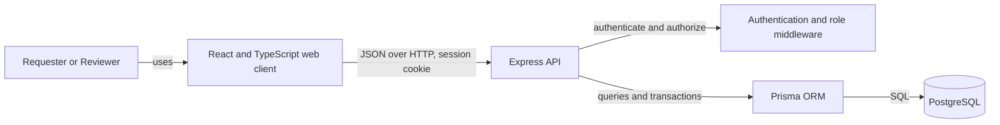

# Part C — System-Level Software Design Specification

## 1. Purpose and design scope

The Workflow and Approval System lets a Requester submit a request, then lets an authorized Reviewer make and record an approval decision. This document describes the system-level design for the product baseline and distinguishes the current Sprint 1 implementation from F-03 work that is still planned.

Sprint 1 is a local working increment. The later cloud deployment design is included for planning; Docker, CI/CD, and GCP deployment are not part of this deliverable.

## 2. Architecture and component responsibilities

| Component | Technology | Responsibility |
|---|---|---|
| Web client | React, TypeScript, Vite | Sign-in form; Requester request form and history; display the workspace for the authenticated role; show validation, loading, empty, and error states. The Reviewer workspace is planned in F-03. |
| API/application layer | Node.js, Express, TypeScript | Authenticate users, identify the current user, enforce role and ownership permissions, validate input, apply workflow rules, and return JSON responses. |
| Database | PostgreSQL with Prisma ORM | Persist users, password hashes, requests, workflow status, ownership, and decision metadata. Prisma schema and migrations define repeatable database structure. |

The browser sends same-origin `/api` requests to the Express API. During local development, Vite proxies `/api` requests to the backend on port 3000. The API uses Prisma to communicate with PostgreSQL. Business rules and authorization are enforced in the API; client-side controls are for usability and are not security controls.

## 3. Data design

The current Prisma schema defines these entities:

| Entity | Important fields | Relationships and constraints |
|---|---|---|
| `User` | `id`, unique `email`, `passwordHash`, `role`, `createdAt` | A user has the `REQUESTER` or `REVIEWER` role. A user may submit many requests and may review many requests. Passwords are stored as bcrypt hashes, never as plain text. |
| `Request` | `id`, `title`, `description`, `status`, `requesterId`, optional `reviewerId`, `createdAt`, optional `decidedAt` | Each request has exactly one Requester owner. It may have one Reviewer recorded for its decision. Requester deletion is restricted while requests refer to that user; deleting a Reviewer sets the optional reviewer link to null. New requests default to `PENDING`. |

`RequestStatus` is `PENDING`, `APPROVED`, or `REJECTED`. The intended workflow permits a decision only while status is `PENDING`. F-03 must save the decision status, Reviewer identity, and decision time together, and reject attempts to decide a request that is no longer pending. The database schema and migration are versioned under `server/prisma/`.

The local database is PostgreSQL, database name `workflow_approval`, on port 5432. The connection string is supplied through `DATABASE_URL`; the actual credential belongs only in the untracked `server/.env`. The Prisma seed procedure creates synthetic Requester and Reviewer accounts for local demonstration. Seed passwords are development-only and must not be reused as real credentials.

## 4. User interface and navigation

| Screen/state | Behavior |
|---|---|
| Sign-in | Accepts email and password, offers show/hide password, and displays an error for failed sign-in. |
| Requester workspace | Provides a request form (title and description) and history showing each saved request and status. An empty-state message appears when there are no requests. |
| Loading/current-user check | On page load, asks the API whether a valid signed-in user exists. A valid Requester’s requests are then loaded. |
| Reviewer workspace | Current code shows a placeholder. F-03 is expected to replace it with a pending-request review screen, decision actions, and suitable loading, empty, validation, and error states. |

Forms require their fields and the API repeats validation. A successful request submission clears the form and reloads the Requester’s history. Network and API failures are shown without exposing internal database or secret details.

## 5. API and access conventions

The API uses JSON for request and response bodies. Protected endpoints require the signed-in identity established by the session cookie. A client-supplied user ID or role is never trusted for authorization or ownership.

### Implemented Sprint 1 endpoints

| Method and path | Access | Purpose and response |
|---|---|---|
| `POST /api/auth/login` | Public | Accepts `{ "email": "...", "password": "..." }`. On success, sets an HTTP-only session cookie and returns user ID, email, and role. Invalid credentials return `401`; malformed input returns `400`. |
| `POST /api/auth/logout` | Public; clears any session cookie | Clears the authentication cookie and returns `204`. |
| `GET /api/auth/me` | Signed-in user | Returns authenticated user ID, email, and role; signed-out or invalid sessions return `401`. |
| `POST /api/requests` | Requester only | Accepts `{ "title": "...", "description": "..." }`. The API derives `requesterId` from the signed-in user and creates a `PENDING` request. Invalid or empty fields return `400`; wrong role returns `403`; signed-out access returns `401`. |
| `GET /api/requests/mine` | Requester only | Returns only requests whose `requesterId` matches the signed-in user. |
| `GET /api/health` | Public local health check | Checks database connectivity and reports whether the database is connected. It does not return private request data. |

### F-03 endpoint design

F-03 must add Reviewer access to pending requests and a decision operation. The exact paths and response shapes must be recorded in the F-03 engineering contract before implementation. At minimum, the API must require the `REVIEWER` role, permit decisions only for `PENDING` requests, persist the decision and Reviewer identity/time, and reject repeated decisions. A Requester must not be able to call these operations successfully.

Errors use a JSON object with a user-safe `error` message. Internal exception details, SQL, passwords, tokens, and secrets are not returned to clients. Endpoint-specific status codes distinguish unauthenticated (`401`), forbidden (`403`), invalid input or invalid workflow state (`400` or the status agreed in the feature contract), missing item (`404`), and unexpected server failure (`500`).

## 6. Role and permission matrix

| Operation | Signed-out visitor | Requester | Reviewer |
|---|---:|---:|---:|
| Sign in | Allowed | Allowed | Allowed |
| Sign out / retrieve current identity | No private identity | Own session only | Own session only |
| Submit a request | Denied | Allowed; ownership comes from session | Denied |
| List own requests | Denied | Allowed; only own records | Denied |
| List pending requests for review | Denied | Denied | Planned in F-03 |
| Approve or reject a pending request | Denied | Denied | Planned in F-03; pending-only rule |

Express authentication and role middleware enforce permissions on the server. F-03 must enforce Reviewer access and pending-only decisions in the API regardless of which controls the client displays.

## 7. Authentication and credential handling

Local passwords are checked with `bcryptjs`; only password hashes are stored. Successful login creates a signed JSON Web Token (JWT) with a one-hour expiry and sends it in an HTTP-only cookie named `accessToken`. The cookie uses `SameSite=Lax`, the `/` path, and `Secure` in production. Browser JavaScript cannot read the HTTP-only cookie. The client retrieves current identity from `GET /api/auth/me`; logout clears the cookie. Protected requests reject missing, expired, invalid, or unknown-user sessions.

The JWT signing secret is provided by `JWT_SECRET` and must be long, random, and private. The database connection string is provided by `DATABASE_URL` and is also private. Both belong in local untracked `server/.env` for development and a secret store for deployment. Neither may be committed to Git, included in client code, or shown in screenshots/PDFs.

## 8. Configuration, reproducibility, and future delivery

| Variable | Purpose | Handling |
|---|---|---|
| `DATABASE_URL` | Connects Prisma to PostgreSQL | Keep the real value in local untracked `server/.env` or deployment secret storage. |
| `JWT_SECRET` | Signs and verifies login tokens | Use a strong random secret in local untracked `server/.env`; use managed secret storage in deployment. |
| `NODE_ENV` | Selects development/production behavior, including secure cookies | Set to `production` in production. |

For this checkpoint, a teammate should be able to install documented Node dependencies, configure local secrets, run committed Prisma migrations and the seed procedure, then start and verify the client and server. The README must record exact setup, migration, seed, build, and test commands before submission.

For Lab 5, the intended design is a Docker-packaged web/API application, managed PostgreSQL with durable storage, and GCP-managed runtime and secret configuration. The application must read configuration from environment variables and must not depend on files inside a disposable application container for database persistence. Actual Docker, CI/CD, and GCP setup are deferred to Lab 5.

## 9. Known design and implementation gaps at this revision

- The Reviewer UI and Reviewer API operations are not yet implemented; they belong to F-03.
- The complete product feature inventory and Sprint 2/Sprint 3 allocation must be completed in Parts B and D.
- Exact F-03 endpoints and decision error behavior must be recorded in its versioned contract before coding.
- F-02 validates non-empty title and description in the API; the client also limits title length to 120 characters. If this maximum is a product rule, enforce it in the API too and document/test it in the F-02 contract.
- This document describes the current design and intended Sprint 1 end state; it does not claim unfinished F-03 behavior is already working.
